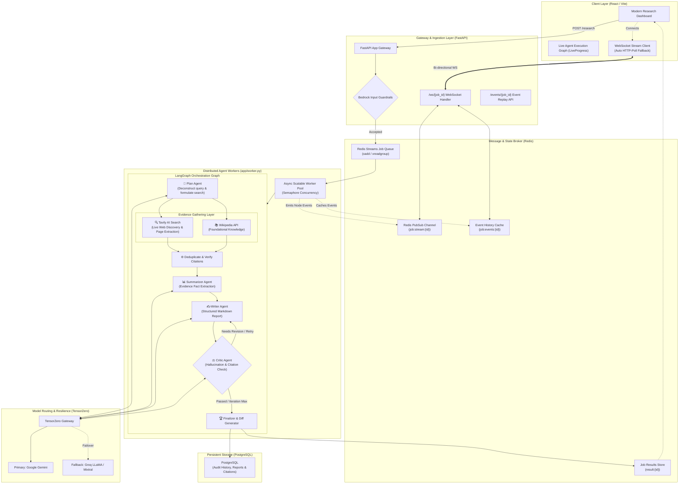

# 🚀 Autonomous Multi-Agent Research Platform

A production-grade, distributed multi-agent research and synthesis platform built with **LangGraph**, **FastAPI**, **Redis Streams**, and **React**. It accepts complex research queries, coordinates specialized autonomous agents to gather real-time evidence across live web tools (**Tavily AI Search** and **Wikipedia**), cross-examines findings with an adversarial critic agent, and streams progress live to the client via **WebSockets**.

---

## 🏗️ System Architecture



---

## ⚡ Key Highlights & Engineering Features

* **🔴 Live WebSocket Streaming**: Every LangGraph agent node publishes real-time execution milestones (queries generated, URLs fetched, citations assembled, critic feedback) through Redis PubSub and WebSockets with an in-memory buffer fallback and automatic heartbeat.
* **🛡️ Resilient Transport**: The frontend leverages dual-mode streaming—streaming through WebSockets with an instantaneous, transparent fallback to HTTP event polling (`/events/{job_id}`) if proxies or firewalls disrupt the socket connection.
* **🤖 Autonomous Multi-Agent Orchestration**:
  1. **Planning Agent**: Decomposes complex user inquiries into focused search queries and coordinates search tools.
  2. **Search Agents**: Concurrently execute **Tavily AI Search** (live web discovery + clean markdown page extraction) and **Wikipedia** with built-in SSRF protection, strict private IP resolution denial, rate limiting, and timeouts.
  3. **Evidence Merger**: Canonicalizes sources, validates URLs, deduplicates findings, and assigns unique citations (`[S1]`, `[S2]`).
  4. **Summarizer Agent**: Synthesizes cross-source evidence and extracts verified facts.
  5. **Writer Agent**: Composes comprehensive reports with precise in-text citations.
  6. **Critic Agent (Adversarial Reviewer)**: Audits drafts for hallucinations, missing context, and invalid citations; loops back to writer if quality thresholds are not met.
* **🔀 Resilient Model Routing (TensorZero)**: Seamless fallback between primary LLM (Google Gemini) and secondary low-latency LLM (Groq) with automated retries.
* **🔒 Enterprise Security & Red-Teaming**:
  * AWS Bedrock Guardrails for input/output safety enforcement.
  * Automated **PyRIT (Python Risk Identification Tool)** red-teaming dashboard with scheduled adversarial prompt attack runs.
* **📦 Scalable Queue & State Management**: Redis Streams with consumer groups (`xreadgroup`), automatic abandoned message recovery (`xclaim`), and dead-letter queues.

---

## 📁 Repository Structure

```
├── app/
│   ├── main.py          # FastAPI application, REST endpoints, and WebSocket /ws/{job_id}
│   ├── streaming.py     # Real-time event publisher, subscriber, and WebSocket connection manager
│   ├── agents.py        # LangGraph state graph, multi-agent definitions, and event hooks
│   ├── tools.py         # Tavily and Wikipedia search clients with security validation
│   ├── worker.py        # Standalone worker loop for horizontal background task scaling
│   ├── queue.py         # Redis Streams consumer group manager and dead-letter handling
│   ├── memory.py        # Redis session memory and PostgreSQL report persistence
│   ├── guardrails.py    # AWS Bedrock input/output safety guardrail validators
│   ├── eval.py          # LLM-as-a-judge automated report evaluation
│   ├── output.py        # Markdown, JSON, and PDF document exporters
│   └── config.py        # Environment configuration and AWS Secrets Manager integration
├── frontend/
│   ├── src/
│   │   ├── App.jsx          # Main research dashboard with WebSocket streaming client
│   │   ├── LiveProgress.jsx # Interactive multi-agent execution timeline component
│   │   ├── styles.css       # Curated dark-mode theme, pulsing radar, and step cards
│   │   └── main.jsx         # React application entry point
│   ├── package.json
│   └── vite.config.js
├── tests/
│   ├── test_platform.py     # End-to-end graph tests, routing, and WebSocket stream tests
│   ├── test_streaming.py    # Unit tests for event pub/sub and in-memory queueing
│   ├── test_queue.py        # Redis Streams retry and claim tests
│   └── test_pyrit_auth.py   # Security authentication tests
├── tensorzero/              # TensorZero gateway config, routing policies, and system prompts
├── terraform/               # Production AWS IaC (VPC, ECS Fargate, ElastiCache, RDS, Secrets)
└── pyrit_dashboard/         # PyRIT adversarial security testing suite and dashboard
```

---

## 🚀 Quick Start (Local Development)

### Prerequisites
* Python 3.12+
* Node.js 18+ (for frontend development)
* Docker & Docker Compose (optional, for containerized run)

### 1. Environment Setup
```powershell
Copy-Item .env.example .env
```
Edit `.env` and provide your API keys:
* `GEMINI_API_KEY`: Primary LLM via Google AI Studio
* `GROQ_API_KEY`: Fallback LLM via Groq Cloud
* `TAVILY_API_KEY`: Web search & page extraction

*(Wikipedia works out of the box with zero keys required.)*

### 2. Run with Docker Compose
```powershell
docker compose up --build
```
This spins up:
* **FastAPI Backend + Frontend**: `http://localhost:8000`
* **Redis**: `localhost:6379`
* **PostgreSQL**: `localhost:5432`
* **TensorZero Gateway**: `http://localhost:3000`

### 3. Frontend Development (Vite)
If editing the frontend with hot-reload:
```powershell
cd frontend
npm install
npm run dev
```
Open `http://localhost:5173`. Vite automatically proxies `/research`, `/result`, `/ws`, and `/events` to FastAPI on port 8000.

---

## 📡 API Reference

### Research Endpoints

#### 1. Submit Research Job
```http
POST /research
Content-Type: application/json
X-API-Key: <your-key>

{
  "topic": "Latest advancements in multimodal reasoning models",
  "output_format": "text",
  "session_id": "optional-session-uuid"
}
```
**Response:**
```json
{
  "job_id": "c4b8e219-...",
  "session_id": "optional-session-uuid"
}
```

#### 2. Live WebSocket Stream
Connect via WebSocket to receive live multi-agent execution events:
```
ws://localhost:8000/ws/{job_id}
```
**Sample Streamed Events:**
```json
{
  "job_id": "c4b8e219-...",
  "type": "plan",
  "step": "planning",
  "title": "Strategy ready: 2 query(ies) across tavily, wikipedia",
  "details": {
    "tools": ["tavily", "wikipedia"],
    "queries": ["multimodal reasoning models 2026", "vision language model reasoning"]
  },
  "timestamp": "2026-10-31T09:35:00Z"
}
```
```json
{
  "job_id": "c4b8e219-...",
  "type": "sources",
  "step": "searching",
  "title": "Assembled and verified 6 unique evidence sources",
  "details": {
    "count": 6,
    "citations": [
      { "citation_id": "S1", "title": "Gemini 2.0 Technical Report", "url": "https://..." }
    ]
  },
  "timestamp": "2026-10-31T09:35:05Z"
}
```
```json
{
  "job_id": "c4b8e219-...",
  "type": "completed",
  "step": "finalizing",
  "title": "Research successfully completed! Final report ready.",
  "details": {
    "report": "# Multimodal Reasoning Advancements...",
    "citations": [...],
    "diff": "..."
  },
  "timestamp": "2026-10-31T09:35:15Z"
}
```

#### 3. Event History (Fallback)
```http
GET /events/{job_id}
X-API-Key: <your-key>
```
Returns all previously recorded timeline events for a given job.

#### 4. Poll Result
```http
GET /result/{job_id}
X-API-Key: <your-key>
```

#### 5. Export Formats
* `GET /result/{job_id}/pdf` — Export professional formatted PDF report with citations.
* `GET /diff/{topic}` — View semantic differential from previous research on the same topic.

---

## 🧪 Testing

Run the test suite across all agents, tools, queue mechanics, guardrails, and streaming:

```powershell
.venv/Scripts/python -m pytest tests/ -v
```

All 20 test cases cover:
* LangGraph state graph routing and critic revision boundaries.
* Tool URL security checks and private IP resolution denial.
* WebSocket streaming event publishing, queue replay, and heartbeat handling.
* Redis Streams failure retries, message claims, and dead-letter queues.
* Bedrock guardrail intervention interception.
* Output formatting (JSON structure validation, PDF generation).

---

## ☁️ Production AWS Infrastructure

Terraform manifests in `terraform/` define an enterprise-ready AWS architecture:
* **Amazon ECS (Fargate)**: Independent autoscaling services for API Gateway and Background Workers.
* **Amazon ElastiCache (Redis)**: Distributed queue, pub/sub streaming, and session store.
* **Amazon RDS (PostgreSQL)**: Multi-AZ persistent relational database.
* **AWS Secrets Manager**: Zero-plaintext secret rotation for LLM and provider keys.
* **Amazon Bedrock**: Automated Guardrails for input toxicity and hallucination mitigation.
* **CloudWatch**: Centralized structured logging and agent metrics.
